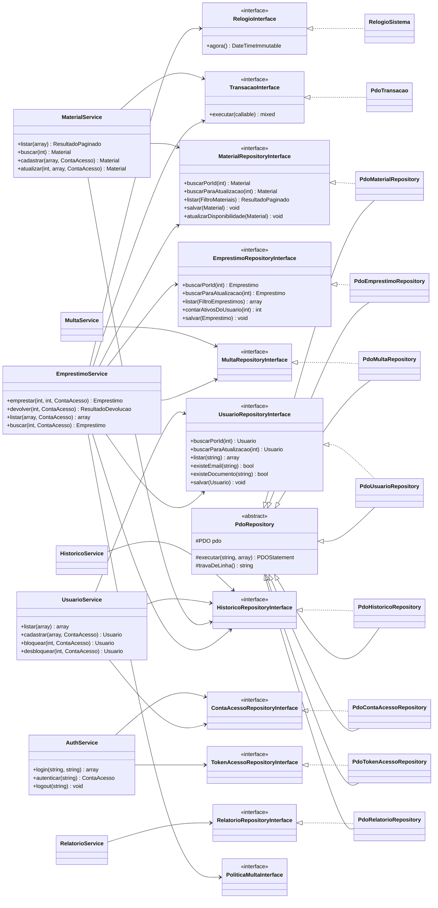
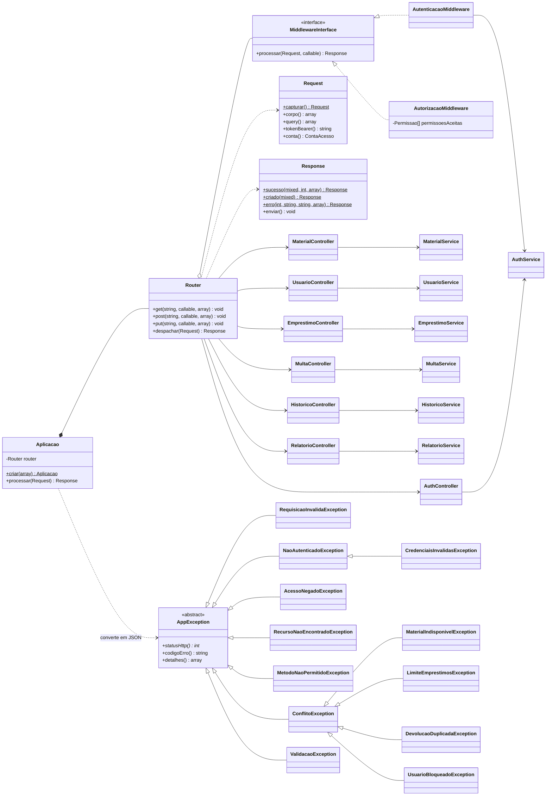
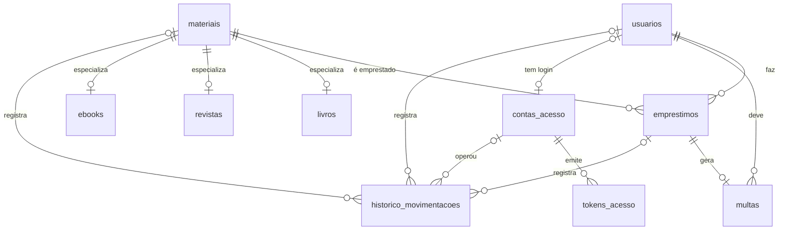

# Diagrama de classes

O diagrama está em Mermaid (abre direto no GitHub, no VS Code com a extensão Markdown Preview Mermaid ou em https://mermaid.live). Foi dividido em três partes para ficar legível. As mesmas imagens, já geradas, estão em `docs/img`:

- `img/uml-dominio.png`
- `img/uml-repositorios-servicos.png`
- `img/uml-http.png`
- `img/modelo-banco.png`

## 1. Domínio

```mermaid
classDiagram
    direction TB

    class Material {
        <<abstract>>
        -int id
        -string titulo
        -string autor
        -int anoPublicacao
        -int quantidadeTotal
        -int quantidadeDisponivel
        +deEntrada(Entrada, int, int)$ Material
        +tipo()* string
        +descricaoTipo()* string
        +prazoBaseEmDias()* int
        +detalhes()* array
        #validarDetalhes()* array
        +estaDisponivel() bool
        +retirarExemplar() void
        +receberExemplar() void
        +quantidadeEmprestada() int
        +toArray() array
    }
    class Livro {
        -string isbn
        -string editora
        -int paginas
        +prazoBaseEmDias() int
    }
    class Revista {
        -int edicao
        -string issn
        +prazoBaseEmDias() int
    }
    class EBook {
        -string formato
        -string urlAcesso
        +prazoBaseEmDias() int
    }
    Material <|-- Livro
    Material <|-- Revista
    Material <|-- EBook
    note for Livro "prazo base de 14 dias"
    note for Revista "prazo base de 7 dias"
    note for EBook "quantidade = acessos simultâneos, prazo de 10 dias"

    class Usuario {
        <<abstract>>
        -int id
        -string nome
        -string email
        -string documento
        -bool bloqueado
        +tipo()* string
        +limiteEmprestimos()* int
        +diasExtrasPrazo()* int
        +multaPorDia()* Dinheiro
        +garantirQueNaoEstaBloqueado() void
        +garantirLimiteDeEmprestimos(int) void
        +bloquear() void
        +desbloquear() void
    }
    class Aluno {
        +limiteEmprestimos() int
        +diasExtrasPrazo() int
        +multaPorDia() Dinheiro
    }
    class Professor {
        +limiteEmprestimos() int
        +diasExtrasPrazo() int
        +multaPorDia() Dinheiro
    }
    class Pesquisador {
        +limiteEmprestimos() int
        +diasExtrasPrazo() int
        +multaPorDia() Dinheiro
    }
    Usuario <|-- Aluno
    Usuario <|-- Professor
    Usuario <|-- Pesquisador
    note for Aluno "limite 3, sem prazo extra, multa R$ 2,00/dia"
    note for Professor "limite 5, +7 dias, multa R$ 1,00/dia"
    note for Pesquisador "limite 7, +5 dias, multa R$ 1,50/dia"

    class Emprestimo {
        -int id
        -int usuarioId
        -int materialId
        -DateTimeImmutable dataEmprestimo
        -DateTimeImmutable dataPrevista
        -DateTimeImmutable dataDevolucao
        -StatusEmprestimo status
        +registrar(Usuario, Material, DateTimeImmutable)$ Emprestimo
        +registrarDevolucao(DateTimeImmutable) void
        +diasDeAtraso(DateTimeImmutable) int
        +estaAtrasado(DateTimeImmutable) bool
    }
    class Multa {
        -int emprestimoId
        -int usuarioId
        -int diasAtraso
        -Dinheiro valor
        -StatusMulta status
    }
    class Movimentacao {
        -TipoMovimentacao tipo
        -string descricao
        -DateTimeImmutable registradaEm
    }
    class ContaAcesso {
        -string email
        -string senhaHash
        -Perfil perfil
        -int usuarioId
        +criar(...)$ ContaAcesso
        +senhaConfere(string) bool
        +pode(Permissao) bool
        +exigirPermissao(Permissao) void
    }
    class TokenAcesso {
        -int contaId
        -string hash
        -DateTimeImmutable expiraEm
        -DateTimeImmutable revogadoEm
        +estaValido(DateTimeImmutable) bool
        +revogar(DateTimeImmutable) void
    }
    class Dinheiro {
        <<value object>>
        -int centavos
        +multiplicar(int) Dinheiro
        +emDecimal() string
    }
    class Perfil {
        <<enumeration>>
        ADMINISTRADOR
        BIBLIOTECARIO
        LEITOR
        +permissoes() Permissao[]
    }
    class Permissao {
        <<enumeration>>
    }

    class PoliticaMultaInterface {
        <<interface>>
        +calcular(Usuario, int) Dinheiro
    }
    class MultaPorDiaDeAtraso
    class MultaComValorMaximo {
        -PoliticaMultaInterface politicaBase
        -Dinheiro valorMaximo
    }
    PoliticaMultaInterface <|.. MultaPorDiaDeAtraso
    PoliticaMultaInterface <|.. MultaComValorMaximo
    MultaComValorMaximo o-- PoliticaMultaInterface : decora

    class MaterialFactory {
        +criar(array) Material
        +reconstituir(array) Material
        +atualizar(Material, array) Material
    }
    class UsuarioFactory {
        +criar(array) Usuario
        +montar(...) Usuario
    }

    Usuario "1" -- "0..*" Emprestimo : realiza
    Material "1" -- "0..*" Emprestimo : é emprestado em
    Emprestimo "1" -- "0..1" Multa : gera
    Usuario "1" -- "0..1" ContaAcesso : acessa por
    ContaAcesso "1" -- "0..*" TokenAcesso : possui
    ContaAcesso --> Perfil
    Perfil --> Permissao
    Multa *-- Dinheiro
    Usuario ..> Dinheiro
    MaterialFactory ..> Material : cria
    UsuarioFactory ..> Usuario : cria
    MultaPorDiaDeAtraso ..> Usuario : usa multaPorDia()
```

## 2. Repositórios e serviços

## 3. Camada HTTP

## Modelo do banco

